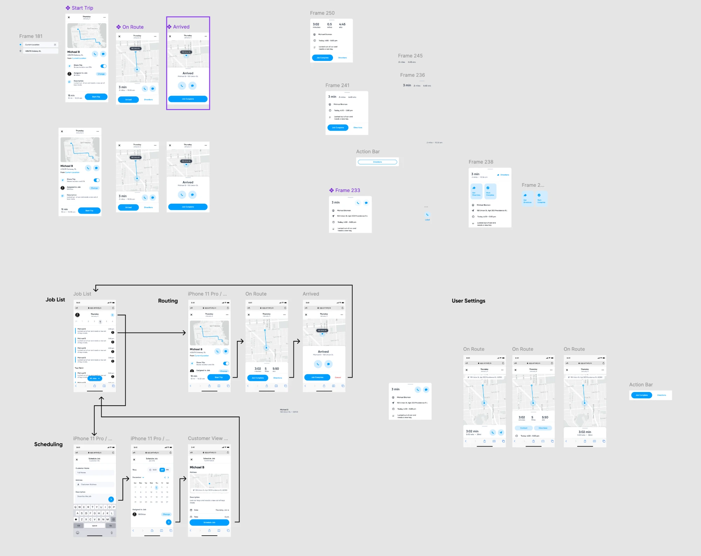

# Arrively — Design Direction

> Status: Draft v0.1 · Applies to: driver app, operator console, customer tracking page

The visual direction comes from an earlier concept ([reference board](design/concept-reference.webp)). Use it **for styling only**. Its flows and features are superseded by [REQUIREMENTS.md](REQUIREMENTS.md). For example, the concept shows the whole route and a "Directions" button for any job, but the requirements reveal one stop at a time.

## 1. Character

Clean, calm, and utilitarian. The design has:

- White surfaces with lots of space.
- One bright blue accent.
- A muted gray map that lets the blue route and markers stand out.
- Very little decoration.

The screen should read at a glance from a driver's seat or a customer's doorstep.

## 2. Color

Sampled from the concept. Exact values can be tuned when building the token set.

| Token | Value | Use |
|---|---|---|
| `primary` | `#009DFE` | Primary buttons, links ("Directions", "Change", "From Current Location"), route line, location dot, toggles, selected date |
| `primary-tint` | `#D2ECFF` | Circular icon buttons (call, message), small pill buttons ("Change"), secondary filled buttons, tiles |
| `surface` | `#FFFFFF` | Screens, cards, bottom sheets |
| `surface-muted` | `#F4F5F7` | Input fields, list backgrounds |
| `text-primary` | near-black `#1A1A1A` | Titles, names, big numbers |
| `text-secondary` | mid gray `#8A8F98` | Labels, dates, metadata ("10 mi · 10:35 am") |
| `divider` | light gray `#E6E8EB` | Hairline separators, sheet drag handle |
| `danger` | red `#FF3B30` | Destructive text actions ("Cancel") |
| `map-label` | dark gray pill `#3C4043` with white text | Address callout on the map |

- Blue is the only accent. Avoid adding other brand colors.
- `danger` appears only as text, never as a large filled area.
- Text and controls must still meet WCAG 2.2 AA contrast (A11Y-1). White text on `#009DFE` is borderline for small text. Use bold weight or a slightly darker blue (around `#0080D6`) for small button labels if testing shows it falls short.
- A dark mode isn't defined yet.

## 3. Typography

- A geometric sans serif. The concept appears to use **Poppins**; confirm against the source file. Use one family across all products.
- **Big numbers** for live status: ETA and stats ("3:02 minutes", "0.5 miles", "4:45 eta") are large and semibold, with a small gray label underneath.
- **Two-line centered headers**: a bold primary line ("Thursday") over a small gray secondary line ("January 4").
- Body and metadata are small and regular weight. The hierarchy comes from weight and color (black vs. gray) more than from size.

## 4. Layout patterns

| Pattern | Description |
|---|---|
| **Top bar** | Close (✕) on the left, two-line centered title, overflow (•••) on the right. No heavy navigation bars. |
| **Map + bottom sheet** | Map fills the upper part of the screen. A white sheet with a small drag handle sits below with the stop details and actions. This is the main pattern for the driver's current stop and the customer tracking page. |
| **Stat row** | Three big numbers in a row (time, distance, ETA) with gray labels. |
| **Detail rows** | Thin line icon on the left (person, pin/arrow, clock, notes), then one or two lines of text. No row borders, just spacing. |
| **Person row** | Name in bold with an address or subtitle in gray, and circular tinted call and message buttons on the right. |
| **Action bar** | Pinned at the bottom. A primary filled pill on the left ("Start Trip", "Job Complete") and a secondary action as blue text ("Directions"), or a red text action ("Cancel"). |
| **Job list** | Date strip at the top (selected day in a blue circle). Rows grouped by date, each with a thin blue accent bar on the left, name in bold, description in gray, time on the right, and assignee avatar. A floating blue pill filter ("All Jobs ▾") near the bottom. |
| **Forms** | Small gray field labels above light gray filled inputs. A round blue "next" button bottom right. A full-width primary pill to confirm ("Schedule Job"). |
| **Settings rows** | Label and description on the left, iOS-style blue toggle or small tinted "Change" pill on the right. |

## 5. Components

- **Primary button**: full pill radius, `primary` fill, white semibold label, short height. Full-width in sheets when it's the only action.
- **Secondary button**: text-only in `primary`, or a `primary-tint` pill with `primary` text ("Contact", "Directions" in the stat variant). An outlined pill also appears in the concept for a single "Directions" action.
- **Icon button**: circular, `primary-tint` fill, `primary` glyph. Used for call, message, navigate.
- **Action tiles**: rounded square `primary-tint` tiles with an icon and a two-word label ("Get Directions", "Mark Complete"). An optional alternative to the action bar.
- **Toggle**: iOS-style, `primary` when on.
- **Avatar**: small circular photo.
- **Map markers**: `primary` dot with a white ring for the driver or current location. Dark gray pill label for an address. Route line in `primary`, medium weight.
- **Cards and sheets**: white, generous inner padding, small corner radius, very soft or no shadow. A small gray drag handle on sheets.
- **Icons**: thin, outlined, single color (`text-secondary` in detail rows, `primary` in buttons).

## 6. Map style

- A desaturated, light gray base map: gray roads, faint labels, no colored land use. With Mapbox, start from a custom style based on "Light" or a monochrome style.
- Blue appears only for Arrively's own layers: route, driver marker, current location.
- The customer's own pin and the driver marker must be clearly different from each other. The concept only shows the driver side, so the customer pin still needs to be designed.

## 7. Applying it to each product

- **Driver app (React Native)**: follows the concept most closely:
  - map and bottom sheet for the current stop
  - stat row for ETA, distance and arrival time
  - an action bar for Arrived, Completed and Directions
  - a job list for history
- **Customer tracking page (mobile web)**: the same map and bottom-sheet pattern, with the stat row adapted to the customer's view (ETA and stops ahead). The Arrively wordmark is small, and the business name is prominent (CUS-9).
- **Operator console (desktop web)**: the same tokens and components on a wider layout. A job list or table on the left, map on the right, and forms in side panels.

## 8. Open items

- Confirm the typeface and exact color values from the source Figma file.
- Arrively logo and wordmark.
- Dark mode.
- Visual states for stale location, delay, and "You're next".
